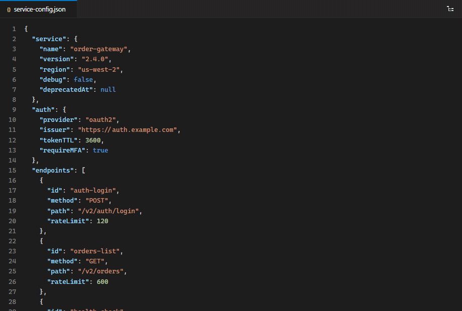
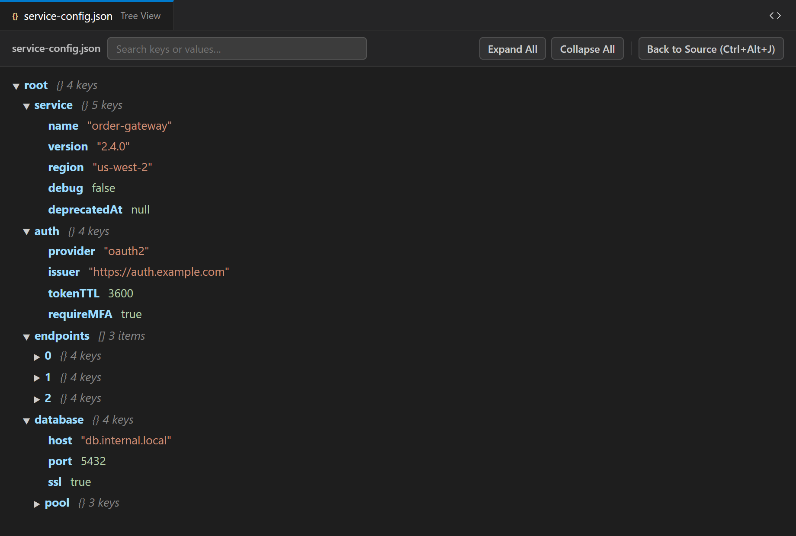
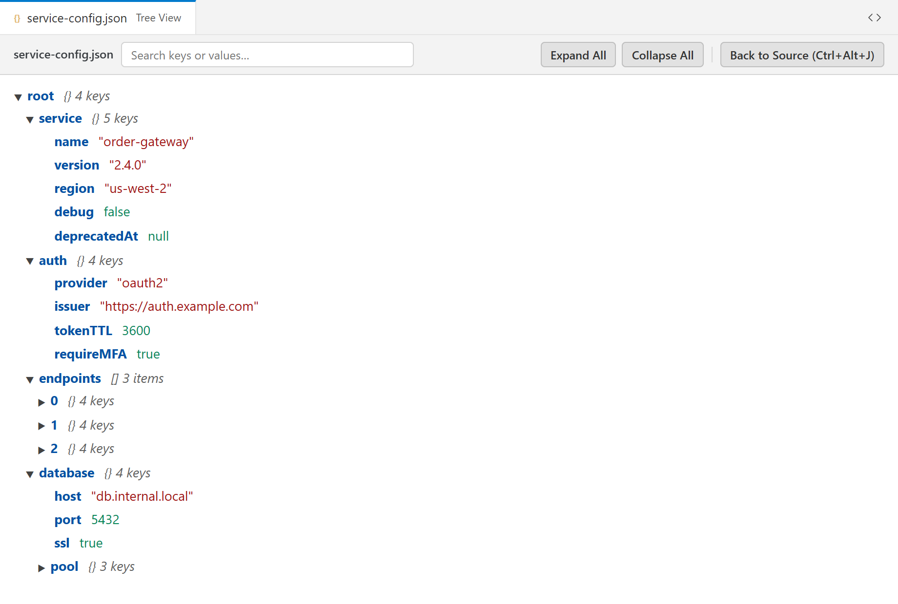
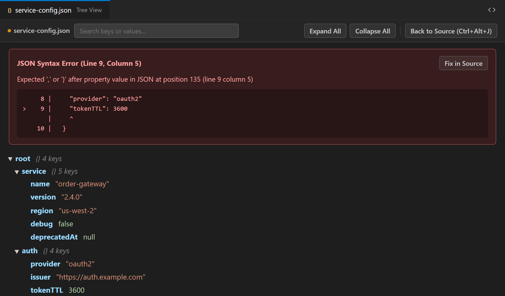

<div align="center">
  

  <h1>JSON Tree Lens</h1>

  <p>
    <strong>A clean, native-themed JSON tree viewer for VS Code.</strong><br />
    Colon-free breathing layout · One-click toggle · Instant search &amp; JSON Path copy · Never hijacks your default editor
  </p>

  <p>
    <a href="https://github.com/Tim-00xx/json-tree-lens/releases">
      
    </a>
    <a href="LICENSE">
      
    </a>
    <a href="https://github.com/Tim-00xx/json-tree-lens/releases">
      
    </a>
  </p>

  <p>
    <strong>English</strong> · <a href="https://github.com/Tim-00xx/json-tree-lens/blob/main/README.zh-CN.md">简体中文</a>
  </p>
</div>

<p align="center">
  
</p>

---

## Native VS Code Theming

Inherits your active VS Code color theme automatically (Dark, Light, and High Contrast) with zero configuration:

<table>
  <tr>
    <th width="50%">Dark Theme</th>
    <th width="50%">Light Theme</th>
  </tr>
  <tr>
    <td></td>
    <td></td>
  </tr>
</table>

---

## Why JSON Tree Lens?

- **Non-intrusive by design** — Registered as an optional custom editor (`priority: "option"`), so VS Code still opens `.json` files in its built-in text editor by default. Switch to the tree view only when you want it.
- **Readable colon-free layout** — Clean sans-serif typography (`13.5px`, `1.65` line height), distinct syntax coloring for keys / strings / primitives, hidden `:` colons with an `8px` breathing gap, and concise collection badges (`[] 3 items`, `{} 4 keys`).
- **Fast search & smart folding** — Opens with the first 2 levels expanded and automatically collapses large arrays to keep first paint fast. Real-time search auto-expands matching branches and highlights every hit.
- **One-click copy workflow** — Click any leaf key (or `Alt`-click any key) to copy its JSON Path (e.g. `endpoints[0].path`). Right-click any node to copy its **JSON Path**, **JSON Value**, **Plain Text (unquoted)**, or **Key Name**.
- **Live sync & inline diagnostics** — Watches document edits in real time. When JSON has a syntax error, it keeps the last valid view intact and surfaces the exact line, column, error reason, and code caret at the top:

<p align="center">
  
</p>

- **Automatic bilingual UI** — Toolbar, tooltips, and context menus follow VS Code's display language (English / Simplified Chinese) automatically.

---

## Installation

### Option 1: Install from GitHub Releases (`.vsix`)

1. Download the latest `.vsix` package from the [Releases](https://github.com/Tim-00xx/json-tree-lens/releases) page.
2. Install it via CLI:
   ```bash
   code --install-extension json-tree-lens-1.0.1.vsix
   ```
   Or in VS Code, open the **Extensions** view (`Ctrl+Shift+X`), click `...` in the top-right corner, and choose **Install from VSIX...**.

### Option 2: Build from Source

```bash
git clone https://github.com/Tim-00xx/json-tree-lens.git
cd json-tree-lens
npm install
npm run package
code --install-extension json-tree-lens-*.vsix
```

---

## Usage & Shortcuts

1. Open any `.json` file in VS Code (or right-click a `.json` file in the **Explorer** sidebar and choose **JSON Tree Lens: Open Tree View**).
2. Press **`Ctrl+Alt+J`** (macOS: **`Cmd+Alt+J`**) or click the **Tree View** icon in the editor title bar to switch to the tree view.
3. Press **`Ctrl+Alt+J`** (macOS: **`Cmd+Alt+J`**) again — or click **Back to Source** in the toolbar / title bar — to return to the text editor.

| Action | Windows / Linux | macOS |
| :--- | :--- | :--- |
| Toggle Tree View / Source Editor | `Ctrl + Alt + J` | `Cmd + Alt + J` |
| Open from File Explorer | Right-click `.json` → **Open Tree View** | Right-click `.json` → **Open Tree View** |
| Copy JSON Path (leaf key) | Left-click key | Left-click key |
| Copy JSON Path (any key) | `Alt + Click` key | `Option + Click` key |
| Copy Path / Value / Plain Text / Key | Right-click any key or value | Right-click any key or value |

> To customize the shortcut, open VS Code **Keyboard Shortcuts** and search for `JSON Tree Lens`.

---

## Development

```bash
npm install          # Install dependencies
npm run watch        # Watch & rebuild extension + webview
npm run typecheck    # Run TypeScript type checks
npm run build        # Production bundle via esbuild
npm run package      # Typecheck, build, and package .vsix
```

Press `F5` in VS Code to launch an Extension Development Host for interactive debugging.

---

## License

[MIT](LICENSE)
