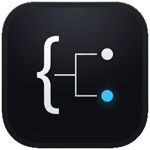
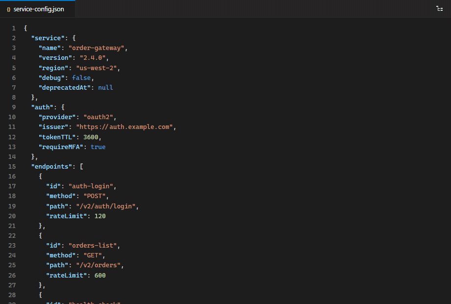
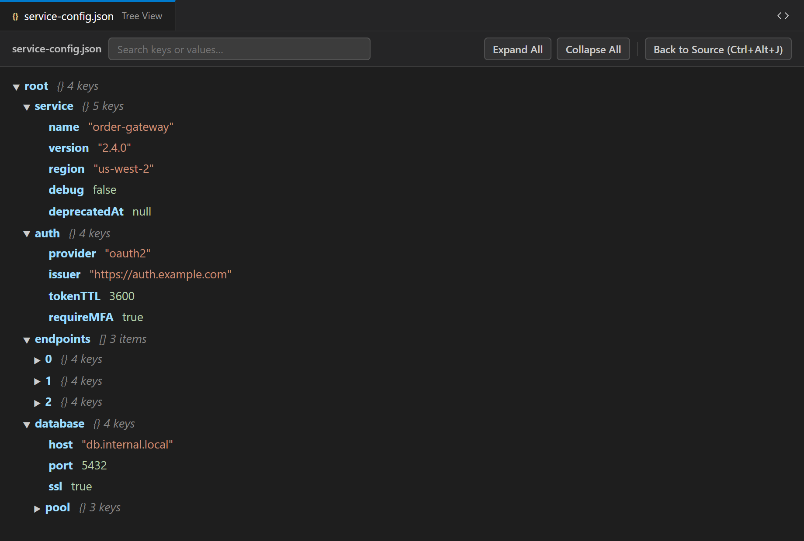
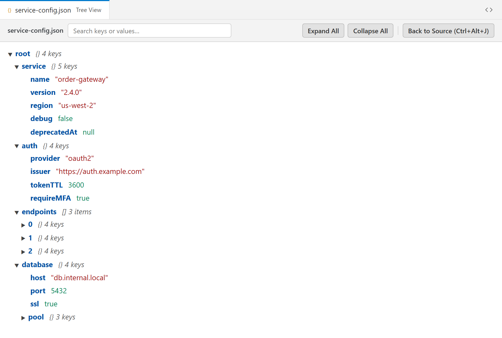
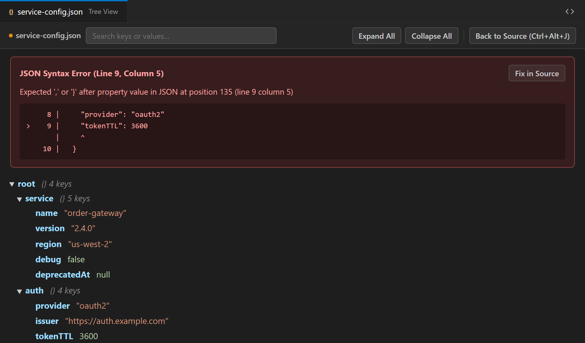

<div align="center">
  

  <h1>JSON Tree Lens</h1>

  <p>
    <strong>原生跟随 VS Code 配色主题的树形 JSON 阅读器</strong><br />
    无冒号呼吸间距排版 · 一键源码/树形切换 · 实时搜索高亮与路径复制 · 不抢占默认编辑器
  </p>

  <p>
    <a href="https://github.com/Tim-00xx/json-tree-lens/releases">
      
    </a>
    <a href="LICENSE">
      
    </a>
    <a href="https://github.com/Tim-00xx/json-tree-lens/releases">
      
    </a>
  </p>

  <p>
    <a href="https://github.com/Tim-00xx/json-tree-lens/blob/main/README.md">English</a> · <strong>简体中文</strong>
  </p>
</div>

<p align="center">
  
</p>

---

## 原生跟随 VS Code 主题配色

无需手动配置，自动跟随当前 VS Code 的浅色、深色与高对比度主题：

<table>
  <tr>
    <th width="50%">深色主题 (Dark)</th>
    <th width="50%">浅色主题 (Light)</th>
  </tr>
  <tr>
    <td></td>
    <td></td>
  </tr>
</table>

---

## 核心特性

- **不抢占默认编辑器** — 以可选自定义编辑器（`priority: "option"`）注册，打开 `.json` 仍默认使用 VS Code 内置源码编辑器，仅在需要阅读结构时一键切换。
- **清爽无冒号排版** — 无衬线字体（`13.5px`，行高 `1.65`），键名 / 字符串 / 原始值清晰语法高亮，隐藏默认冒号 `:` 并保留 `8px` 呼吸间距，搭配直观集合统计标签（`[] 3 items`、`{} 4 keys`）。
- **实时搜索与智能折叠** — 默认展开前 2 层，大数组自动折叠避免卡顿；顶部搜索框支持实时过滤高亮并自动展开匹配分支。
- **高效复制体验** — 左键点击叶子键名（或 `Alt+点击` 任意键名）即可复制 JSON Path（如 `endpoints[0].path`）；右键任意节点可复制 **JSON Path**、**节点值 (JSON)**、**纯文本（无引号）** 或 **键名**。
- **实时同步与语法诊断** — 自动监听文档修改并同步刷新；JSON 语法出错时不白屏，顶部直接显示精确行号、列号、错误原因与定位片段，并可一键跳回源码修复：

<p align="center">
  
</p>

- **中英文界面自适应** — 工具栏、提示与右键菜单自动跟随 VS Code 界面语言（中文 / 英文），并根据系统自动显示 `Ctrl+Alt+J` 或 `Cmd+Alt+J`。

---

## 安装方式

### 方式一：从 GitHub Releases 下载 `.vsix` 安装

1. 前往 [Releases](https://github.com/Tim-00xx/json-tree-lens/releases) 页面下载最新版本的 `.vsix` 安装包。
2. 通过命令行安装：
   ```bash
   code --install-extension json-tree-lens-1.0.1.vsix
   ```
   或在 VS Code 中打开 **扩展** 侧边栏（`Ctrl+Shift+X`），点击右上角 `...` → **从 VSIX 安装...**。

### 方式二：从源码本地构建

```bash
git clone https://github.com/Tim-00xx/json-tree-lens.git
cd json-tree-lens
npm install
npm run package
code --install-extension json-tree-lens-*.vsix
```

---

## 使用方法与快捷键

1. 在 VS Code 中打开任意 `.json` 文件（或在左侧 **资源管理器** 中右键 `.json` 文件，选择 **JSON Tree Lens: Open Tree View**）。
2. 按 **`Ctrl+Alt+J`**（macOS：**`Cmd+Alt+J`**），或点击编辑器右上角标题栏的 **树形视图图标** 切换到树形视图。
3. 再次按 **`Ctrl+Alt+J`**（macOS：**`Cmd+Alt+J`**），或点击顶部工具栏 / 标题栏的 **切换回源码** 按钮即可返回文本编辑器。

| 操作 | Windows / Linux | macOS |
| :--- | :--- | :--- |
| 切换树形视图 / 源码编辑器 | `Ctrl + Alt + J` | `Cmd + Alt + J` |
| 从资源管理器直接打开 | 右键 `.json` → **Open Tree View** | 右键 `.json` → **Open Tree View** |
| 复制叶子节点的 JSON Path | 左键点击键名 | 左键点击键名 |
| 复制任意节点的 JSON Path | `Alt + 点击` 键名 | `Option + 点击` 键名 |
| 复制路径 / 值 / 纯文本 / 键名 | 右键点击任意键名或值 | 右键点击任意键名或值 |

> 如需自定义快捷键，可在 VS Code **键盘快捷方式** 中搜索 `JSON Tree Lens`。

---

## 本地开发

```bash
npm install          # 安装依赖
npm run watch        # 监听模式构建扩展与 Webview
npm run typecheck    # TypeScript 类型检查
npm run build        # 使用 esbuild 生产构建
npm run package      # 检查、构建并打包 .vsix
```

在 VS Code 中按 `F5` 即可启动扩展调试宿主窗口（Extension Development Host）。

---

## 开源协议

[MIT](LICENSE)
